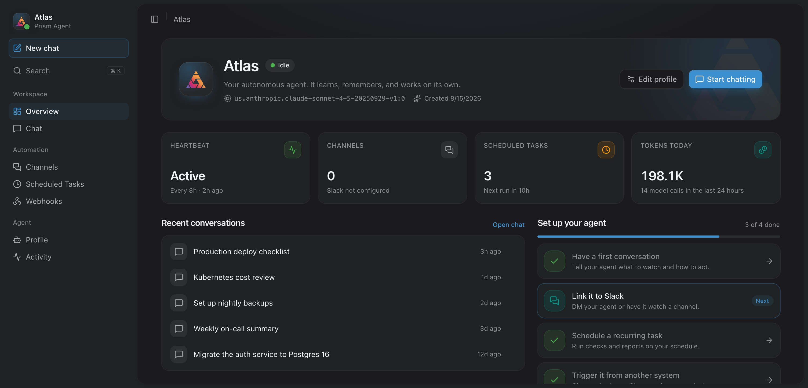
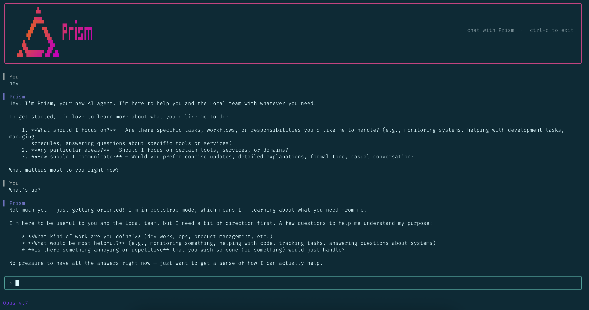

# Prism Agent

[](https://github.com/lensapp/prism-agent/actions/workflows/test.yml)
[](https://github.com/lensapp/prism-agent/actions/workflows/lint.yml)
[](https://github.com/lensapp/prism-agent/actions/workflows/e2e.yml)
[](https://github.com/lensapp/prism-agent/actions/workflows/docker-build.yml)
[](https://github.com/lensapp/prism-agent/actions/workflows/create-binary.yml)
[](https://github.com/lensapp/prism-agent/actions/workflows/release-canary.yml)
[](https://github.com/lensapp/prism-agent/actions/workflows/release-production.yml)

> Standalone agent runtime: long-lived AI agent with persistent memory,
> scheduled work, heartbeat checks, and Slack/WebSocket chat — running
> in a single container.

## What Prism Agent is

Prism Agent is self-contained. One container, one embedded database, no
external services. State, conversation flow, scheduled work, channel adapters,
and tool execution all run in-process. The only hard runtime dependency is an
LLM provider.

The agent is not a chatbot session — it persists between conversations,
maintains its own memory, runs heartbeat checks on a schedule, can put work on
its own calendar, and can act over a shell.

## Documentation

Full user docs live in **[`docs/`](docs/README.md)** — installation (native,
Docker, Lens Sandbox), the [Web UI](docs/web-ui.md) and
[Terminal UI](docs/terminal-ui.md), [Slack](docs/slack.md), and a guide to every
feature: [identity](docs/agent-identity.md), [memory](docs/memory.md),
[heartbeat](docs/heartbeat.md), [scheduled tasks](docs/scheduled-tasks.md),
[tools](docs/tools.md), and [configuration](docs/configuration.md).

## Web UI



## Terminal UI



## Quick Start

### One-line install

#### macOS / Linux

```bash
curl -fsSL https://raw.githubusercontent.com/lensapp/prism-agent/main/install.sh | bash
```

Installs the `prism` (terminal UI) and `prism-server` (runtime) binaries
into `~/.prism`, puts `prism` on your `PATH`, and registers `prism-server`
to run always via launchd (macOS) / systemd (Linux).

`AWS_BEARER_TOKEN_BEDROCK` is required for chat. If it's exported in your
shell when you run the installer, it's baked into `~/.prism/.env`
automatically and the service comes up working out of the box:

```bash
export AWS_BEARER_TOKEN_BEDROCK=<your-key>
curl -fsSL https://raw.githubusercontent.com/lensapp/prism-agent/main/install.sh | bash
```

Otherwise the installer writes `~/.prism/.env` with empty placeholders —
edit it and restart the service
(`launchctl kickstart -k "gui/$(id -u)/com.prism.server"` on macOS,
`systemctl --user restart prism-server` on Linux).

#### Windows

```powershell
irm https://raw.githubusercontent.com/lensapp/prism-agent/main/install.ps1 | iex
```

Installs `prism.exe` and `prism-server.exe` into `%USERPROFILE%\.prism`, adds
that directory to your user `PATH`, and registers a `PrismServer` scheduled
task that starts `prism-server` at logon and restarts it on failure. Needs no
admin elevation, and pulls in no dependencies — Windows already ships
everything the installer uses.

As on macOS/Linux, export `AWS_BEARER_TOKEN_BEDROCK` before running to bake it
into `%USERPROFILE%\.prism\.env` so the service comes up working:

```powershell
$env:AWS_BEARER_TOKEN_BEDROCK="<your-key>"
irm https://raw.githubusercontent.com/lensapp/prism-agent/main/install.ps1 | iex
```

Otherwise edit `%USERPROFILE%\.prism\.env` and restart the service
(`Restart-ScheduledTask -TaskName PrismServer`).

### Using Lens Sandbox

[Lens Sandbox](https://github.com/lensapp/lens-sandbox) runs the same
published image inside a local microVM, with inbound and outbound access
checked against policy:

```bash
curl -fsSL https://get.lns.run | bash   # install the lns CLI (macOS on Apple Silicon)

lns run --cpus 2 --mem 2048 \
  -p 3003:3003 -v prism-data:/data \
  ghcr.io/lensapp/prism-agent:latest \
  -- /bin/sh -c './start.sh > /dev/null 2>&1 & exec prism'
```

The flags mirror the Docker command below: the agent's SQLite database
persists in the `prism-data` named volume (`lns volume ls`), and the run
attaches to your terminal interactively by default. The sandbox supplies
the Bedrock credential at the network boundary, so you don't pass it into
the run. Start it from a project directory, where `lns` keeps the policy
governing the run. The first time the agent reaches out, the service raises
an approval prompt for the outbound connection; answering "always" remembers
it so future runs proceed without asking.

### Using Docker

Start the agent and boot into terminal ui:

```bash
docker run -it -p 3003:3003 -v prism-data:/data -e AWS_BEARER_TOKEN_BEDROCK ghcr.io/lensapp/prism-agent:latest /bin/sh -c './start.sh > /dev/null 2>&1 & exec prism'
```

`AWS_BEARER_TOKEN_BEDROCK` must be set in your shell environment — `-e
AWS_BEARER_TOKEN_BEDROCK` (no `=`) passes the value through from the
parent shell. The agent's SQLite database is persisted in the
`prism-data` named volume across container restarts.

## Features

### Conversational interface

Real-time chat over WebSocket and Slack. Supports DMs and channel
conversations and multi-turn threads.

### LLM models

Default models:

- **Main loop**: Claude Opus 5
- **Classification gates**: Claude Haiku (fast heartbeat delivery and optional tool-risk decisions)
- **Embeddings**: Amazon Titan v2 (Bedrock default; other platforms via `EMBEDDING_PROVIDER`)

All three are configurable. Heartbeat and scheduled (cron) runs use the main
loop model by default, but each can be pointed at its own model — e.g. a
cheaper model for routine heartbeats while chat stays on a stronger one. Set
them from the Profile page, the TUI (`/heartbeat-model`, `/cron-model`), or as
bootstrap defaults in `~/.prism/settings.json`; leave them empty to inherit the
main model.

Prompt caching is built in: the stable parts of the system prompt — identity,
curated memory, vision, operating manual — cache across turns; only the dynamic
parts (timestamps, recalled memories) re-process.

### Tools the agent can use

Out of the box, the agent has tools for:

- **Memory** — search, write, delete entries in its long-term memory store.
- **Self-management** — edit its own personality, the profile of its user,
  its curated memory, vision, operating manual, heartbeat checks, and
  runtime settings, all from inside the conversation.
- **Scheduling** — create, list, run, and delete scheduled tasks using
  natural language (`"in 5 minutes"`, `"every weekday at 9am"`) or raw
  cron expressions.
- **Shell** — run commands, read/write/edit files, spawn long-running
  processes, manage their I/O, and delegate coding tasks to Claude Code or Codex.

### Memory

Two layers, both persisted in the embedded database:

1. **Curated memory** — a markdown summary the agent maintains itself, always
   present in its system prompt. Bounded, durable, low-latency recall of the
   things the agent has decided are worth keeping permanently.
2. **Searchable memory** — an embedding-indexed store for everything else,
   queryable by meaning rather than keyword. Embeddings come from the
   configured embedding platform (Bedrock Titan v2 by default); vector search
   runs on the embedded SQLite database.

### The agent's "self"

Each agent is defined by a small set of markdown documents:

| Document | Purpose | Usually maintained by |
|----------|---------|-----------------------|
| **Soul** | Personality, values, boundaries | User |
| **User** | What the agent knows about the person it's working for | Agent |
| **Memory** | Curated long-term knowledge | Agent |
| **Vision** | The user's goals for the agent | User |
| **Agent guide** | The operating manual the agent follows | User |
| **Heartbeat** | The checks the agent performs on its schedule | User |
| **Bootstrap** | First-run onboarding instructions, cleared once complete | Agent |

Together they form the agent's identity — change them and the agent changes.
Every write records a revision, so the Profile page lists a document's history,
shows the difference between two revisions, and restores an earlier one.

### Heartbeat

An always-on monitoring loop. Default cadence is every 8 hours, configurable
per agent. On each tick, the agent runs the checks defined in its heartbeat
document, then a fast classification model (Haiku) decides whether the result
is worth bothering the user with — DELIVER or SUPPRESS. Identical alerts
within 24 hours are suppressed by full-text comparison, so the agent doesn't
re-page on the same finding.

Heartbeats can also be **Slack-triggered**: messages in designated trigger
channels queue, and incoming traffic wakes the heartbeat between scheduled
runs. Pending messages are drained atomically so no message is orphaned, even
if multiple arrive while the agent is busy.

The heartbeat's reasoning runs on the main model by default, or a
heartbeat-specific model if one is set (the Haiku DELIVER/SUPPRESS gate is
always its own fast model).

### Scheduled tasks

The agent puts work on its own calendar. Tasks can be one-shot or recurring,
specified in natural language or cron syntax, and survive restarts. One-shot
tasks delete themselves after running; recurring tasks track their last run,
their next run, and consecutive errors. The agent can list, run-now, or
cancel its own tasks. Scheduled runs pass the same DELIVER/SUPPRESS gate as
heartbeats — instruction-aware, so an unconditional "send me X" task always
delivers while a conditional check with nothing to report stays silent.
Scheduled runs use the main model by default, or a
scheduled-task-specific model if one is set. A one-shot task can also
**continue in the current conversation** when it fires — so the agent can
"wait" for something and resume in the same thread (the same Slack thread,
web, or terminal conversation) instead of starting a new one.

### Webhooks

External systems push events at the agent instead of the agent polling for
them. Each webhook is a named subscription — created on the Web UI's
**Webhooks** page — with its own endpoint (`POST /agents/webhooks/<name>`),
an optional event-type filter, an optional prompt template with payload
substitution (`{field.path}`, `{__raw__}`), and a delivery target (all
channels, web chat, or Slack). Agent runs are asynchronous (`202 Accepted` +
run id, result delivered to your channels); a **deliver-only** mode posts the
rendered template directly with zero LLM cost. Works out of the box with
Alertmanager, PagerDuty, GitHub, or any sender that can POST JSON — see
[docs/webhooks.md](docs/webhooks.md).

### Voice meetings

The agent can join a **Google Meet** call and take part by voice — ask it in chat and
it requests to join signed into its own Google account, a host admits it like any
other participant, and from then on it listens and speaks in the room. It keeps its
tools during the call, so it can look something up and say the answer without leaving.
Interrupt it and it yields the floor; a short "mm-hm" won't cut it off. Needs the
container image (which ships Chromium, Xvfb and PulseAudio) plus managed OpenAI
or a direct voice credential. Realtime audio uses the Lens endpoint when managed
OpenAI is configured, independently of the chat provider. Speaking is how it answers, and it can
put one short line — a link, an id, a command to paste — into the call's own chat panel.
Work it can't finish in the call it schedules as a one-off task, and that result lands in
your chat afterwards. Nothing else leaves a call, and nothing about the meeting is
recorded. It has its full toolset otherwise (everything but `share_file`), including the
tools that change its own configuration.
A meeting isn't an authenticated channel and the guardrail is prompt-level — it
announces and confirms before anything destructive — so a meeting link effectively
grants the agent's authority, over itself included. See
[docs/voice-meetings.md](docs/voice-meetings.md).

### Voice chat

A client can also talk to the agent **directly**, with no meeting in between: the
audio rides the same chat connection, and the agent keeps its tools and its
authority while you speak. It needs the same Realtime credential as a meeting and
nothing else, so it works wherever chat works — a hosted sandbox and the
installed binary included. See [docs/voice-chat.md](docs/voice-chat.md).

### Sessions and idle handling

A configurable daily reset (default 4 AM local time) and idle timeouts give
the agent a clean break between logical "days." This keeps long-running
context from compounding indefinitely.

### Safety controls

- **Step limit** — at most 100 tool-use steps per turn. When the agent hits
  the cap, a tool-less follow-up call asks it to summarize what it found
  rather than spinning further.
- **Output cap** — 16,000 tokens per generation.
- **Per-tool output limits** — large tool responses are truncated before
  reaching the model, so a single tool call can't flood context.
- **Delivery classification gate** — heartbeat and scheduled-task results
  pass programmatic checks first (empty responses are dropped; heartbeats
  also suppress exact 24-hour duplicates; scheduled-run error messages
  always deliver); the LLM gate only runs if those pass; if the gate itself
  errors, the message is delivered (fail-open).

### Observability

- **Structured logs** by default (Pino).
- **Langfuse tracing** for every LLM call — model, tokens, tool calls,
  latency. Enabled by setting Langfuse keys; disabled otherwise.
- **OpenTelemetry log export** to a configured collector. Disabled when no
  endpoint is set.

## How it runs

One container, one agent. The embedded database lives in the container at
`/data/agent.db` (or `prisma/sqlite/agent.db` next to the schema when running
locally without Docker) and is the only persistence.

## Getting started

### Local development

```bash
npm install
AWS_BEARER_TOKEN_BEDROCK=<bedrock-key> npm run dev
```

The runtime listens on port `3003`. Health check:

```bash
curl http://localhost:3003/health
```

On first boot with an empty database, Prism Agent auto-creates the workspace
using `AGENT_NAME`, `TEAM_NAME`, and `OWNER_USER_ID`. Subsequent boots find
the existing workspace and reuse it.

### Docker

```bash
docker build -t prism .
docker run -p 3003:3003 \
  -v prism-data:/data \
  -e AWS_BEARER_TOKEN_BEDROCK=<bedrock-key> \
  prism
```

Mount a volume at `/data` so the agent's database survives container
restarts.

## Configuration

### Credentials

| Variable | Purpose |
|----------|---------|
| `AWS_BEARER_TOKEN_BEDROCK` | Bedrock API key. The AI SDK auto-selects bearer auth when this is set |
| `SLACK_BOT_TOKEN` | Slack bot token. Validated via `auth.test` on boot when set |
| `SLACK_APP_TOKEN` | Slack app-level token for Socket Mode |

### Optional

| Variable | Purpose | Default |
|----------|---------|---------|
| `PORT` | HTTP port | `3003` |
| `PRISM_HOST` | Interface to listen on. The default accepts connections from this machine only; `0.0.0.0` accepts them from the network, which the Docker image sets so a published port works | `127.0.0.1` (Docker: `0.0.0.0`) |
| `LLM_PROVIDER` | LLM platform: `bedrock`, `azure`, `bedrock-mantle`, `openai`, `openrouter`, or `anthropic` — see [Configuration](docs/configuration.md#provider-selection) for the non-default platforms' credentials and model IDs | `bedrock` |
| `EMBEDDING_PROVIDER` | Memory-embedding platform, independent of `LLM_PROVIDER`: `bedrock`, `azure-openai`, `openai`, `openrouter`, or `none` — see [Configuration](docs/configuration.md#memory-embeddings) | derived from `LLM_PROVIDER` |
| `DATABASE_URL` | SQLite URL. The local default resolves to `prisma/sqlite/agent.db` (Prisma's schema-relative rule); the Docker image's `start.sh` overrides to `file:/data/agent.db` so the mounted `/data` volume is used | `file:./agent.db` (Docker: `file:/data/agent.db`) |
| `AGENT_ID` | Pin the agent's UUID. When unset, a fresh UUID is generated on first boot and reused on subsequent boots via the workspace row in the DB | generated |
| `NEXUS_API_URL` | Base URL of the Lens Agents instance used for WebSocket authorization and the MCP/LLM proxy | `http://localhost:3002` |
| `AGENT_NAME` | Display name on first boot | `Prism` |
| `TEAM_NAME` | Team name on first boot | `Local` |
| `OWNER_USER_ID` | Owner user ID on first boot. The default is a local sentinel — Slack identity linking later overlays the real `lensUserId` per-message | `00000000-0000-0000-0000-000000000001` |
| `BEDROCK_MODEL_ID` | Main model | `global.anthropic.claude-opus-5-5` |
| `BEDROCK_CLASSIFICATION_MODEL_ID` | Heartbeat gate model | `global.anthropic.claude-haiku-4-5-20251001-v1:0` |
| `BEDROCK_EMBEDDING_MODEL_ID` | Embedding model | `amazon.titan-embed-text-v2:0` |
| `AWS_REGION` | AWS region | `us-east-1` |
| `CONTEXT_WINDOW_TOKENS` | Context window to assume for the context-usage indicator; only needed for a model the catalog doesn't know | derived from the model ID |
| `MODELS_DEV_URL` | Opt in to refreshing the model-window catalog from a registry at startup (e.g. `https://models.dev/api.json`); unset means no outbound call, bundled catalog only | — (disabled) |
| `SLACK_EXPECTED_APP_ID` | Optional safety check on the Slack app identity | — |
| `OPENAI_API_KEY` | Enables [voice meetings](docs/voice-meetings.md) and [voice chat](docs/voice-chat.md) (legacy direct-OpenAI voice credential; managed voice resolves its own endpoint and key); also the chat credential when `LLM_PROVIDER=openai`, and the default embedding credential when `LLM_PROVIDER=anthropic` | — (disabled) |
| `ANTHROPIC_API_KEY` | Chat credential when `LLM_PROVIDER=anthropic` (the first-party Anthropic API; always direct — no gateway mount) | — |
| `OPENAI_REALTIME_MODEL` | Realtime model for the agent's voice, in a meeting and in a voice chat (pinned snapshot) | `gpt-realtime-2.1` |
| `MEETING_TIMEOUT_MINUTES` | Hard cap on one meeting call | `60` |
| `LANGFUSE_SECRET_KEY` | Enables Langfuse tracing when set | — |
| `LANGFUSE_PUBLIC_KEY` | Langfuse public key | — |
| `LANGFUSE_BASE_URL` | Langfuse server | `http://localhost:3100` |
| `OTEL_EXPORTER_OTLP_ENDPOINT` | Enables OpenTelemetry log export | — |
| `OTEL_EXPORTER_OTLP_API_KEY` | API key sent as `x-api-key` to the collector | — |

## Interfaces

Prism Agent exposes the following surfaces:

- **WebUI** — a built-in browser UI served by the runtime. Chat with the
  agent, browse threads, view and edit all seven identity documents,
  inspect scheduled tasks,
  and watch heartbeat history. Available on the same port as the runtime.
- **TUI** — a terminal UI for chatting with the agent and managing its
  state from the shell. Useful for headless servers and SSH sessions, and
  the natural fit when running Prism Agent alongside jahe-CLI.
- **WebSocket** — real-time chat for a UI or CLI. Streamed responses,
  status updates, and tool-call events.
- **Slack** — runs in Socket Mode. Once the agent's Slack workspace is wired
  up, DMs and channel mentions reach the agent directly without a public
  webhook. Six-character verification codes link Slack identities to the
  agent's user.
- **Management API** — REST endpoints for agent lifecycle, scheduling,
  thread management, and Slack mappings. Useful for building a UI or driving
  Prism Agent from a control plane.
- **Health endpoint** — `GET /health` for orchestrators.

## Development

| Command | What it does |
|---------|--------------|
| `npm install` | Install dependencies and generate the database client |
| `npm run dev` | Start in watch mode (auto-restart on changes) |
| `npm run worktree -- <name>` | Create a worktree and launch Claude Code (requires `claude` on PATH) |
| `npm run worktree -- --codex <name>` | Create a worktree and launch Codex (requires `codex` on PATH) |
| `npm run build` | TypeScript compile to `dist/` |
| `npm start` | Run the compiled build |
| `npm test` | Run the test suite in watch mode |
| `npm run test:run` | Single test run |
| `npm run test:coverage` | Coverage report |
| `npm run db:migrate` | Apply database migrations |
| `npm run prisma:generate` | Regenerate the database client |

## License

Apache License 2.0. See [LICENSE](LICENSE).

Some files are copied or adapted from third-party projects. See
[THIRD_PARTY_NOTICES](THIRD_PARTY_NOTICES).
