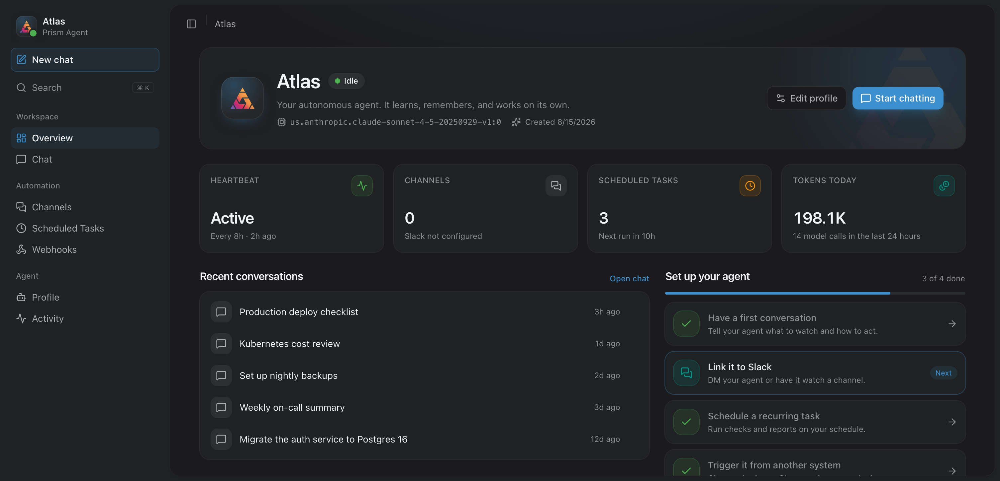

# Prism Documentation

Prism is a self-contained AI agent. One container, one embedded database, no
external services. It persists between conversations, keeps its own memory,
runs heartbeat checks on a schedule, can put work on its own calendar, and can
act over a shell — all running in a single process. The only hard dependency is
an LLM provider.

These docs walk you from a first install through every feature the agent has.

## Getting started

- **[Getting Started](getting-started.md)** — prerequisites, the fastest path
  to a running agent, and your first conversation.

## Running Prism

Three ways to run the same agent. Pick one.

- **[Install natively](installation.md)** — the one-line installer puts the
  `prism` (terminal UI) and `prism-server` (runtime) binaries on your machine
  and runs the runtime as a background service (launchd / systemd / Scheduled
  Task). Best for everyday local use.
- **[Run with Docker](docker.md)** — pull the published image and run the
  agent in a container with a persistent data volume.
- **[Run with Lens Sandbox](lens-sandbox.md)** — run the same image inside a
  local microVM with every outbound connection checked against a policy you
  control.

## Interfaces

How you talk to the agent.

- **[Web UI](web-ui.md)** — the browser UI served by the runtime: chat, threads,
  agent profile, scheduled tasks, heartbeat controls, and Slack linking.
- **[Terminal UI](terminal-ui.md)** — the `prism` TUI for chatting and managing
  the agent from the shell, including slash commands, the `--resume` picker, and
  the schedules/config panels.
- **[Slack](slack.md)** — run the agent in Slack DMs and channels: linking,
  threads, formatting, and Slack-triggered heartbeats.

## Features

What the agent can do.

- **[The agent's identity](agent-identity.md)** — the markdown documents that
  define an agent: Soul, User, Memory, Vision, Agent Guide, Heartbeat, and
  Bootstrap.
- **[Memory](memory.md)** — the two-layer memory system: curated long-term
  memory plus an embedding-indexed searchable store.
- **[Heartbeat](heartbeat.md)** — the always-on monitoring loop, its
  DELIVER/SUPPRESS gate, duplicate suppression, and Slack triggers.
- **[Scheduled tasks](scheduled-tasks.md)** — putting one-shot and recurring
  work on the agent's calendar with natural language or cron.
- **[Tools](tools.md)** — everything the agent can call: memory, self-management,
  scheduling, shell, file sharing, and the Claude Code sub-agent.
- **[Sessions & safety](sessions-and-safety.md)** — daily resets, idle handling,
  the safety limits that bound every turn, and observability.

## Reference

- **[Configuration](configuration.md)** — every environment variable the
  runtime reads, with defaults.
- **[CLI reference](cli-reference.md)** — `prism` flags, slash commands, keyboard
  shortcuts, and the `~/.prism/settings.json` file.

## How it runs

One container, one agent. The embedded database (SQLite with vector search)
holds everything: agent identity, conversation history, memory, scheduled
tasks, and Slack mappings. When you install natively it lives under your install
directory; in Docker it lives in the `/data` volume at `/data/agent.db`. There
is no separate datastore to stand up — back up that one file and you've backed
up the whole agent.
