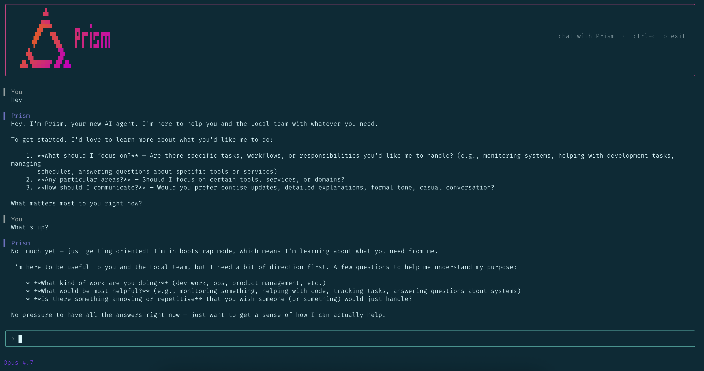

# Terminal UI

`prism` is a terminal UI for chatting with the agent and managing its state
without leaving the shell — useful on headless servers, over SSH, or just as a
fast keyboard-driven alternative to the browser.



```bash
prism
```

By default it connects to a runtime at `http://localhost:3003`. Point it
elsewhere with `PRISM_HTTP_URL` or the `~/.prism/settings.json` file — see the
**[CLI reference](cli-reference.md)** for all flags and settings.

When your provider needs setup, `prism` lists its requirements under **Connect a model provider**.

## Starting and resuming conversations

- **Fresh start.** Running `prism` with no flags creates a new conversation
  thread and drops you into the chat view.
- **Resume.** Run `prism --resume` to pick a previous conversation from a
  list. The picker shows each thread's title, how long ago it was active, and
  the working directory (and git branch) it was started in. Select one with the
  arrow keys and Enter; Escape cancels.
- **One conversation.** When the agent keeps
  [one conversation](web-ui.md#one-conversation), `prism` always opens it with its
  recent history, and `--resume` shows no picker. Its commands run where the
  conversation started, whatever directory you start `prism` in: the agent's
  workspace, or the directory of the `prism` session that created it.

To switch to a different thread mid-session, exit and relaunch with `--resume`.

## Chatting

Type your message and press **Enter** to send. While the agent is working, a
spinner above the input reads "thinking… (esc to stop · enter sends)" — press
**Escape** to cancel the in-flight response. Each agent message shows which tools
it used; press **Ctrl+O** to expand the latest message's tool calls and see their
inputs and outputs.

**You can keep typing while the agent works, and Enter sends.** A message sent
mid-response is handed to the turn already running: the agent picks it up at its
next step and changes course, so "actually, skip the tests" lands while the tests
are still running instead of being answered minutes later. Anything that arrives
too late for the running turn is answered together in one follow-up rather than
one reply per message. Escape still means "stop the turn" — it never clears what
you have typed, and a cancelled turn leaves your draft intact.

**Run a shell command with `!`.** Type `! <command>`, for example `! aws sso login`,
to run the command in your own terminal, with prompts and browser sign-ins
working as usual. The command, its exit code and its output then go to the
agent as your message, and the agent continues from there.

**Other clients on the same conversation.** A message someone else sends to this
conversation, from the web or a phone, shows under their name. While the agent
works on another conversation, the spinner says it is waiting for that one to
finish. A message the agent could not accept is marked "not sent". If the agent
has been updated past this version of `prism`, it says so and stops; update
`prism` to keep chatting.

**Status in the terminal tab.** `prism` reports its state with the
[OSC 7501](https://www.superlogical.com/rex/docs/build/program-status) program
status sequence. A terminal that supports it shows, in the tab or window, when
the agent is working, waits for your sign-in, has replied, or has failed.

Use **Up / Down** arrows from an empty input to walk back through your message
history.

Press **Ctrl+C** (or run `/exit`) to quit.

## Slash commands

Type `/` to open a command popup; keep typing to filter, **Tab** or **Enter** to
complete the selection, then **Enter** to run. The available commands:

| Command | What it does |
|---------|--------------|
| `/help` | List all commands |
| `/copy` | Copy the most recent message to the clipboard |
| `/attach <path>` | Stage a file (≤10 MB) to send with your next message; offers path completion |
| `/detach` | Remove all staged attachments |
| `/save [dir\|file]` | Save files the agent shared in its last message to disk |
| `/rename <name>` | Rename the agent (up to 64 characters of letters, digits, spaces and `- ' . &`) |
| `/model <id\|reset>` | Set the agent's model, or `reset` to the server default |
| `/heartbeat-model <id\|reset>` | Set the heartbeat model, or `reset` to inherit the main model |
| `/cron-model <id\|reset>` | Set the scheduled-task model, or `reset` to inherit the main model |
| `/model-mode [auto\|fixed]` | Show the model mode, or switch between Auto and Fixed; the Auto models are set on the Profile page |
| `/heartbeat <…>` | Control the heartbeat — see below |
| `/goal <…>` | Set or manage a background [goal](#goal) — see below |
| `/skills [list\|run <name>]` | List installed [skills](skills.md), or run one |
| `/plugins` | List installed [plugins](plugins.md) and what each contributes |
| `/compact` | Summarize older history to free up context — see [Compaction](compaction.md) |
| `/schedules` | Open the scheduled-tasks panel |
| `/webhooks` | Open the webhooks panel |
| `/config` | Open the identity/config viewer panel |
| `/exit` | Shut down the TUI |

### `/heartbeat`

Manage the agent's [heartbeat](heartbeat.md) inline:

- `/heartbeat status` — show whether it's active/running, last run, errors, and
  interval
- `/heartbeat start` / `/heartbeat stop` — enable or disable it
- `/heartbeat trigger` — run a heartbeat right now
- `/heartbeat every 5m` or `/heartbeat every 2h` — set the interval (1 minute to
  7 days)

### `/goal`

Set or manage a **background goal** — an objective the agent keeps working toward
across multiple turns until it's done:

- `/goal <objective>` — set a goal in plain language and start it
- `/goal` or `/goal status` — show the current goal's status (turns, tokens)
- `/goal list` — list all goals
- `/goal pause` / `/goal resume` — pause or resume the active goal
- `/goal stop` (aliases `clear`/`cancel`/`off`) — stop the active goal

The same `/goal` command is also available in the **[Web UI](web-ui.md#chat)**.

### Attaching and saving files

`/attach ./report.pdf` stages a file; it shows above the input with a `/detach`
hint, and is sent with your next message. The agent sees the file as a metadata
stub and inspects it on demand via its [attachment tools](tools.md#attachments)
— text/code/archives are hydrated to disk and read with shell tools; images can
be viewed visually inline. When the agent shares files back, `/save` writes them
to the current directory — or pass a target: `/save ./out/` for a directory, or
`/save ./out/report.pdf` to name a single file. File content is kept for 7
days unless [`ATTACHMENT_TTL_HOURS`](configuration.md#core) sets another time;
expired attachments show `(expired)` in the history and `/save` reports that the
content is gone.

### Images in replies

In kitty 0.28 or later, Ghostty, Rio 0.3.11 or later, Rex, and any terminal that
reports kitty's Unicode placeholders, an image the agent places in its reply is
drawn at its place in the text. Every other terminal, and these terminals inside
tmux or screen, shows `[image: …]` there.
An image in a table cell always shows as `[image: …]`.

## Panels

Panels replace the chat view temporarily; **Escape** closes them.

### Schedules panel (`/schedules`)

Lists the agent's [scheduled tasks](scheduled-tasks.md) with their name,
schedule, next run, and active state. From the list:

- **n** — create a new schedule (a form with Name, Schedule, and Instruction
  fields; Tab/arrows to move between fields, Enter to submit)
- **e** — edit the selected schedule in the same form
- **d** — delete the selected schedule (confirm with **y**)
- arrow keys to navigate

### Webhooks panel (`/webhooks`)

Lists the agent's [webhook subscriptions](webhooks.md) with where each one
delivers, whether it runs the agent, and whether it is active. **Space** pauses
or resumes the selected subscription. **Enter** opens a form for its
description, events, delivery target, Slack channels, deliver-only mode and
prompt; **Space** checks a Slack channel or opens the prompt in your editor, and
**Enter** saves the form. Create
subscriptions and set their authentication on the Web UI's
[Webhooks](web-ui.md#webhooks) page.

### Config panel (`/config`)

A two-pane viewer for the agent's identity. The left pane shows the agent's
name, model (plus the heartbeat and scheduled-task models, or `(main)` when they
inherit it), timezone, and heartbeat status, plus a list of the seven identity
documents (Soul, User, Memory, Heartbeat, Vision, Agent, Bootstrap). The right pane shows the selected document's content. Use Tab or the
left/right arrows to move between panes, up/down to scroll, and Page Up/Down to
page through long documents. It's a viewer: ask the agent to change a document
(see **[The agent's identity](agent-identity.md)**), edit any of the seven on the
Web UI's Profile page, or edit the **Agent** guide here with `/agent-guide`.

### Sign-in panel

Opens by itself when the agent's [computer](computer.md) is blocked by a sign-in
that a username and a password answer. Tab or the arrows move between the two
fields, the password is shown as dots, Enter signs in, and **Escape** closes the
panel and leaves the request for the Web UI. The agent is stopped while the
sign-in is typed in and is never given the password.

### Editing the agent guide (`/agent-guide`)

`/agent-guide` opens the agent guide in your editor — `$VISUAL`, else `$EDITOR`,
else `vi` — as a temporary markdown file. Save and quit and the CLI stores the
document; quit without saving, or abort (`:cq` in vi), and it stays as it was.
The agent has no tool that writes this document, so this and the Web UI's
**Agent** tab are the only ways it changes.

## Status bar

The bottom status bar shows the current model (pretty-printed, e.g. "Opus 5")
and a red indicator with a message if the connection drops. The TUI reconnects
to the runtime automatically with backoff, buffering anything you send while
it's offline.

Next to the model, it shows how much of the model's context window this
conversation has consumed — e.g. `| context 58%`. It changes colour as the window
fills. It is hidden if the runtime does not recognize the model's context window —
see `CONTEXT_WINDOW_TOKENS` in the **[configuration reference](configuration.md)**
for how to set the window size in that case.

When the window fills up, the runtime **[compacts](compaction.md)** the
conversation and the percentage drops. While that runs, the spinner row above
the composer reads `compacting conversation…`, and a system line
(`Conversation compacted — N older messages summarized.`) appears in the chat
when it finishes. `/compact` triggers the same thing manually.

For the complete flag list, settings file, and full keyboard-shortcut tables,
see the **[CLI reference](cli-reference.md)**.
