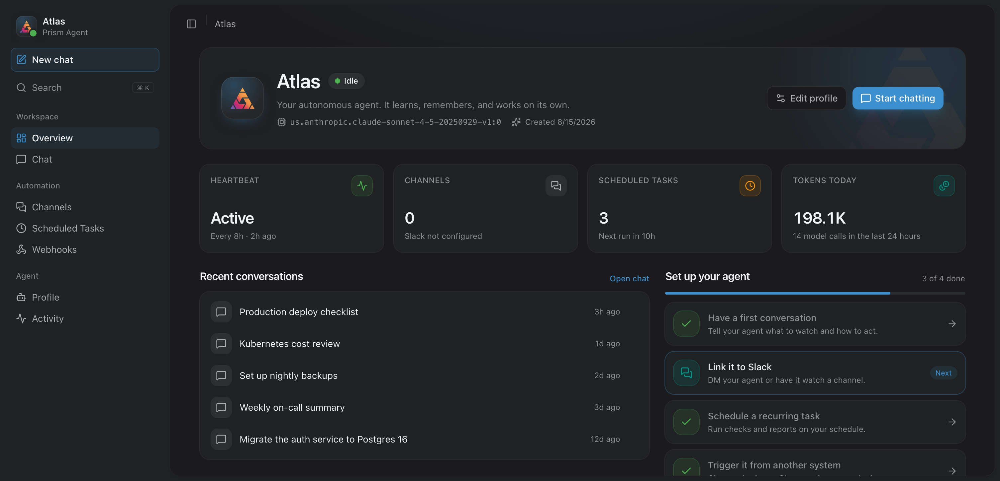

# Web UI

The runtime serves a browser UI on the same port it listens on. Open it at:

```
http://localhost:3003
```

(In local development with Vite it's at <http://localhost:5173>, which proxies
to the runtime.)



The UI is organized around a left sidebar with six sections: **Overview**,
**Chat**, **Channels**, **Scheduled Tasks**, **Webhooks**, and **Profile**.

## Overview

The landing page. It shows the agent's status (RUNNING / IDLE / ERROR), its
heartbeat state, a count of linked Slack channels, the number of scheduled
tasks, and when the agent was created. The stat cards are clickable shortcuts
into Profile, Channels, Scheduled Tasks, and Chat. (To rename the agent, use the
Name field on the [Profile](#profile) page.)

## Chat

The main conversation surface.

- **Sending messages.** Type in the input pinned to the bottom and press send.
  Responses **stream** in as the agent works — you see intermediate text from
  multi-step responses in real time rather than one block at the end.
- **Slash commands.** Type `/` to open a command popup, the same as the
  **[Terminal UI](terminal-ui.md#slash-commands)**: filter by typing, **Tab** to
  complete, arrow keys to move the selection, **Enter** to run. The web supports
  `/help`, **`/skills`** (list installed [skills](skills.md), or `/skills run
  <name>`), **`/goal`** (set or manage a background goal — `/goal
  <objective>`, `status`, `list`, `pause`, `resume`, `stop`), and **`/compact`**
  (summarize older history to free up context — see
  **[Compaction](compaction.md)**). Commands run
  locally and call the runtime directly; their output appears as a system note
  in the conversation, and `/goal`/`/skills run` stream the agent's reply in.
- **Attachments.** Attach files with the paperclip button or by drag-and-drop.
  Pending attachments show as chips (with a progress spinner, name, and size)
  and can be removed before sending. Up to 100 attachments per message.
- **Stopping.** While the agent is responding, the send button becomes a stop
  button that cancels the in-flight turn.
- **Tool calls.** When the agent uses a tool, the message shows an
  expandable section with the tool name, its input, and its output — so you can
  see exactly what it did.
- **Markdown & downloads.** Agent messages render as markdown (headings, lists,
  code blocks with highlighting, links). Files the agent shares back appear as
  downloadable chips.
- **Threads.** Each conversation is a thread. Recent threads are listed in the
  sidebar under **Chat** (newest first); click one to reopen it. Start a fresh
  conversation with the pen button next to the **Recents** heading — clicking
  it again while the new thread is still empty reuses that thread instead of
  piling up empty ones. The thread ID is in the URL (`/chat/<threadId>`), so
  conversations are deep-linkable. A new thread is also created automatically
  on your first message, and gets an auto-generated title once it has content.
- **Connection status.** A small indicator shows the live WebSocket connection
  state (connected / connecting / disconnected / error); it reconnects
  automatically.
- **Context used.** Above the input, the right-hand side shows how much of the
  model's context window this conversation has consumed — e.g. `58% context
  used`. Hover it for the exact token counts and the model they were measured
  against. It updates live as the agent works, and survives a page reload. It is
  hidden when the agent is set to a model the runtime doesn't recognize — see
  `CONTEXT_WINDOW_TOKENS` in the **[configuration reference](configuration.md)**.

  The **[Terminal UI](terminal-ui.md#status-bar)** shows the same figure, in a
  more compact `| context 58%` form.

  When the window fills up, the runtime **[compacts](compaction.md)** the
  conversation: older history is folded into a summary and the meter drops.
  While that runs, a `Compacting conversation…` note appears in the strip above
  the input, and a system note (`Conversation compacted — N older messages
  summarized.`) lands in the chat when it finishes. `/compact` triggers the same
  thing manually.

## Channels (Slack)

Link the agent to Slack here. The page reflects whether a Slack workspace is
configured at all (it needs `SLACK_BOT_TOKEN` + `SLACK_APP_TOKEN` in the
runtime's environment — see **[Slack](slack.md)**).

Two modes:

- **Personal Mode (DM).** Link your Slack account so you can DM the agent.
  Click **Link Account** to generate a six-character verification code (it
  expires in ~15 minutes), then DM that code to the agent in Slack. Once linked,
  the page shows the linked DM; you can **Unlink** to undo.
- **Team Mode (channels).** Invite the agent to channels. Click **Add channel**
  to generate a channel link code, invite the agent to the channel, and post the
  code there. You can link **multiple** channels — they're listed in a table,
  each with an **Unlink** action. One channel is the **main channel** (marked ★);
  it's where heartbeat alerts post. Use **Set main** to move it. The first
  channel you link becomes main by default.

Personal and Team modes are mutually exclusive — unlink one before switching to
the other.

The page also manages **heartbeat triggers**: designate a Slack channel so that
incoming messages wake the agent's heartbeat, with a configurable throttle
(minutes : seconds) between triggers. See
**[Heartbeat](heartbeat.md#slack-triggered-heartbeats)**.

## Scheduled Tasks

List, create, and delete the agent's cron-driven runs.

- The table shows each task's name, its cron schedule (e.g. `0 9 * * *`), and
  its last run time.
- **Create** opens a form: a name, a cron expression, and an optional
  instruction describing what the agent should do on each tick.
- **Delete** removes a task after a confirmation.

The Web UI's create form takes raw cron expressions. (The agent itself, and the
TUI, also accept natural-language schedules like "every weekday at 9am" — see
**[Scheduled tasks](scheduled-tasks.md)**.)

## Webhooks

Let external systems trigger the agent by POSTing JSON to a named endpoint.

- **Enable Webhooks** turns the inbound receiver on (it starts disabled); the
  toggle applies immediately, no restart.
- **New subscription** creates a named route (`/agents/webhooks/<name>`) with
  an optional description, an event-type filter, a delivery target (All
  channels / Chat / Slack), a **deliver only** mode that posts the rendered
  payload without running the agent, and an optional prompt template.
- Each row shows the endpoint path with a copy button, an **Active** switch
  (disabled subscriptions reject events), and a delete action.

See **[Webhooks](webhooks.md)** for the endpoint contract, prompt-template
syntax, and copy-paste Alertmanager/PagerDuty/GitHub configs.

## Profile

The agent's identity and runtime controls.

- **Name & models.** Edit the agent's display name (1–64 characters) and its LLM
  model ID inline. **Reset** returns the main model to the runtime default.
  Separate **Heartbeat model** and **Scheduled-task model** fields let you run
  those on their own model; leave a field empty to inherit the main model (the
  field shows the model it falls back to). See
  **[Configuration → Models](configuration.md#models)**.
- **Chat delivery.** A toggle switches between **Concise** (default) and
  **Verbose** mode. In concise mode only the agent's final message is delivered;
  intermediate steps are persisted but not shown. See
  **[Configuration → Chat verbosity](configuration.md#chat-verbosity)**.
- **Identity documents.** Seven tabs show the agent's markdown documents —
  **Agent** (guide), **Soul**, **User**, **Heartbeat**, **Memory**, **Vision**,
  and **Bootstrap**. These are **read-only viewers** in the Web UI: the agent
  edits them itself during conversation (e.g. you ask it to update its soul or
  it records something to memory). See **[The agent's identity](agent-identity.md)**.
- **Heartbeat controls.** A status panel shows whether the heartbeat is Active
  or Stopped, its interval, the last run time, and a consecutive-error count.
  Buttons let you **Start**, **Stop**, or **Trigger now**, and you can edit the
  interval inline (1–10080 minutes). See **[Heartbeat](heartbeat.md)**.
- **Backup & restore.** **Export** downloads a `.prism` snapshot of the entire
  agent — chat history, memory, scheduled tasks, settings, and Slack mappings.
  **Restore** replaces the agent from a `.prism` file (a destructive operation;
  the runtime restarts and the page reconnects when it's back).

## Behind the scenes

The Web UI is a single-page app that talks to the runtime over its REST API and
a WebSocket at `/api/ws` for real-time chat, typing indicators, status changes,
and thread updates. There's no separate login for the bundled single-agent
runtime — it serves your one agent directly.
